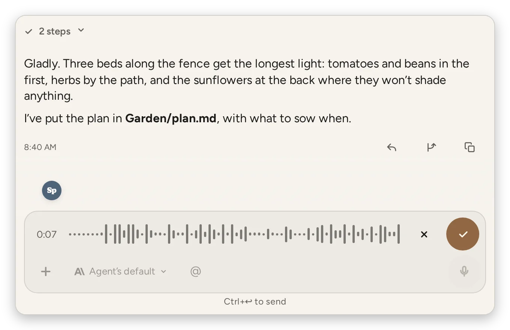
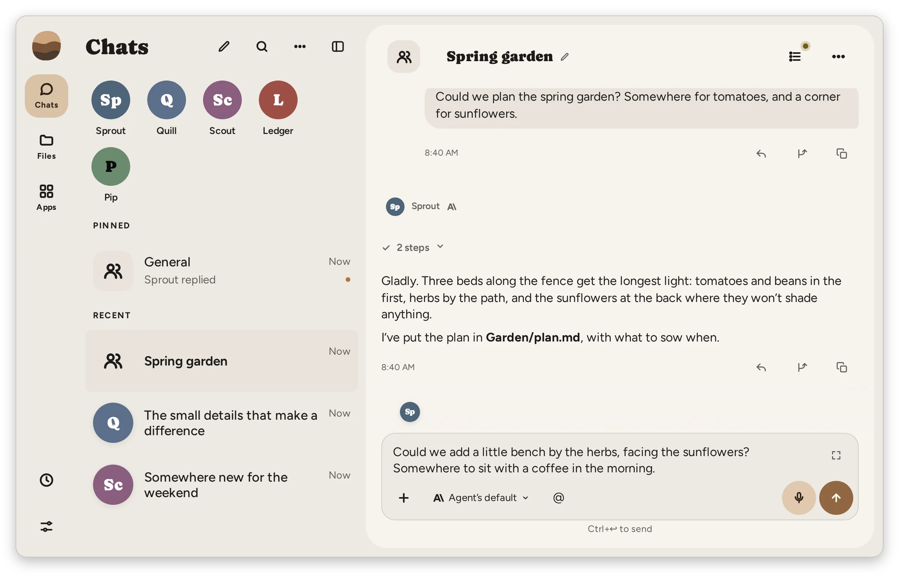
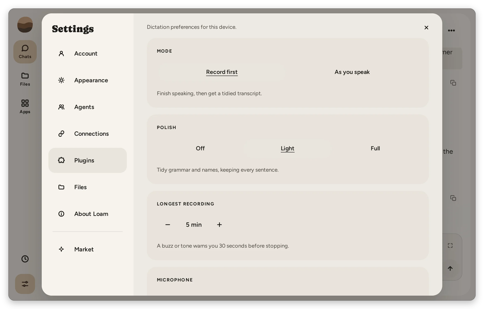
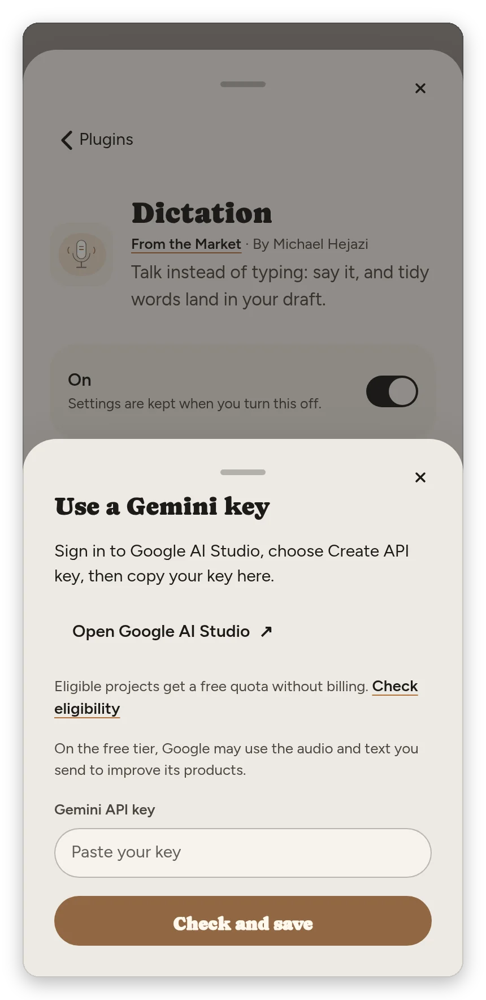

# Dictation

<!-- loam:hero -->
**Talk instead of typing: say it, and tidy words land in your draft.**
<!-- /loam:hero -->

A plugin for [Loam](https://github.com/loamhq/loam). Press the microphone,
speak, and your words land in the draft, tidied the way you like. Sending the
message or saving the file is still yours to do.

<!-- loam:gallery -->

*Press the mic and talk. Take your time; it listens.*

*Your words land in the draft, tidied. Sending is still yours.*

*Choose how much it tidies: Off, Light or Full.*

*Add one shared Gemini key in Settings.*
<!-- /loam:gallery -->

## What you can do

- **Talk anywhere you type**: the composer, the bigger editor, and notes in
  Files.
- **Get tidy words, not a transcript.** *Polish* chooses how much: *Off*
  keeps your words with the fillers removed, *Light* tidies grammar and names
  and keeps every sentence, *Full* tidies and organises sentences, paragraphs
  and lists.
- **Be understood.** It knows the names of your agents and threads, and the
  terms in your dictation terms note with Record first. Create or open the
  note from Names and terms in Dictation settings and add one name or term
  per line.
- **Record first, or watch it write as you speak.** Record first (the
  default) with a server key is recorded, then written down and tidied. As you speak uses your
  browser's own speech recognition and writes while you talk.

## How to use it

Press the microphone in the composer or Files and speak. Press ✓ to keep the words. With no key, As you speak uses your browser’s recognition. Browser support varies. Record first and Polish use a server key.

Open Settings › Plugins › Dictation to see the provider. When the plugin is using this browser, follow the free Gemini key link, sign in to Google AI Studio, create a key and paste it in the guide. Loam checks it and saves it in Settings › Connections › API keys for both plugins.

## What you need, and what leaves your server

Loam uses a Google key first, then an OpenAI key, then the browser. A provider error stays with that provider. Record first sends your audio and vocabulary to the selected provider. Polish sends the transcript and terms to that same provider. As you speak may send audio to the browser vendor.

Eligible projects can use Google’s free quota without setting up billing. Google may use free-tier inputs and outputs to improve its products. Quotas vary by project and model. Google restricts API use to eligible regions and professional or business development. Serving users in the EEA, Switzerland or the UK requires paid services. [Google terms](https://aistudio.google.com/docs/terms) · [Available regions](https://aistudio.google.com/docs/available-regions) · [Project limits](https://aistudio.google.com/rate-limit)

---

Version 1.2 adds an optional OpenAI key and a connection to api.openai.com. Loam asks you to review this new access when updating.

## Technical details

### What it touches

- **api.openai.com** handles audio, vocabulary and text for transcription and polish when OpenAI is selected.
- **Your microphone**, only while you are recording. Turning the plugin off
  releases it.
- **generativelanguage.googleapis.com** when Google is selected: a recorded take goes there from
  this plugin's own server on your Loam, which holds the key. The server supplies the key on that request.
- **Your browser's recognition service**, in As you speak only.
- **Conversation records, read only**: your agents' and threads' names, to
  bias what it hears. It never sends a message for you.

### Settings

When dictation uses browser speech, the composer offers a free Gemini key
for better results. Choose **Don’t show again** to dismiss the offer across
devices. The key guide stays in Dictation preferences.

Settings › Plugins › Dictation keeps your mode in this browser. Record first
also shows Polish, the longest recording (1 to 15 minutes, 5 by default),
microphone selection, and Names and terms. Your device keeps its recording
choices when you switch modes or turn the plugin off. Record first reads the
terms note fresh for every take.

### Install from the Market

Open Settings › Market and search for **Dictation**. The listing links to the maker’s repository and shows the exact version available.

### For builders

[PLUGIN.md](PLUGIN.md) is its manifest. Plain ES modules with no build step
and no dependency: `page/main.js` registers the composer's tools and the
settings section through Loam's plugin interface (API 0), and
`page/engine.js` is the recorder and its states. `server/` is its own small
server (Node's standard library), which Loam runs while the plugin is on and
reaches at `/x/dictation/`: `POST transcribe` takes a take and answers the
words, and `GET terms` reads your vault's terms note. It holds the key; the
page holds none. Needs Loam 0.2.3 or later. Loam's own repository runs this
plugin's tests against its copy in `plugins/_listed/dictation/`. The pictures
are from Loam's demo world (`app/tools/capture-plugin-shots.mjs`).

## License

Under the AGPL-3.0 ([LICENSE](LICENSE)), as Loam is.
